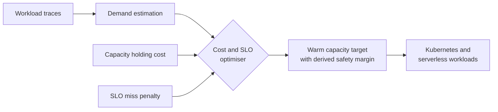

<!-- Banner -->

  

<!-- Typing line -->

  

  
  
  

 

  

<!-- What I'm doing -->
<h2 align="center">
  
  &nbsp;What I'm Doing
</h2>

<i>The work that fills my days right now</i>

 

 &nbsp;Building and automating platforms on Kubernetes with CI/CD and GitOps  
 &nbsp;Exploring ways to make cloud native infrastructure more cost efficient  
 &nbsp;Improving reliability through better monitoring and observability  
 &nbsp;Learning to design systems that are repeatable, scalable and easy to operate

  

  

<!-- About me -->
<h2>
  
  &nbsp;About Me
</h2>

> I build, automate and operate software platforms that stay simple under pressure. I started out in software development and now focus on DevOps and Platform Engineering. I care less about whether something runs once and more about how it is deployed, observed, scaled and kept healthy at 3 a.m.

 

  

<!-- Experience -->
<h2>
  
  &nbsp;Experience
</h2>

<h3>Intern Operations Engineer &nbsp;at&nbsp; Sysco LABS</h3>

<code>May 2025 to May 2026</code>

I supported production applications and operational workflows in a live support environment, investigating incidents with Amazon CloudWatch, Datadog and ServiceNow. Much of my time went into troubleshooting data movement problems such as CDC latency and failing scheduled jobs, and I contributed documentation and automation that cut down repetitive operational work.

 

  

<!-- Currently building -->
<h2 align="center">
  
  &nbsp;Currently Building
</h2>

<i>Research in progress</i>

 

<h3>
  
  &nbsp;WarmStock
</h3>
<h4><i>Cost and SLO aware warm capacity for Kubernetes and serverless</i></h4>

Keeping capacity warm costs money, and keeping too little of it costs SLO misses. Most teams pick a safety margin by gut feeling. WarmStock treats that margin as an **output of an optimisation**, balancing the cost of holding ready capacity against the penalty of requests that miss their performance objective.

<h4>Why it matters</h4>

<table>
  <tr>
    <td align="center" width="260">
       
      <b>Less idle spend</b> 
      Stops paying for capacity that sits warm but never serves a request
    </td>
    <td align="center" width="260">
       
      <b>Fewer SLO misses</b> 
      Keeps enough capacity ready so latency sensitive requests avoid cold starts
    </td>
    <td align="center" width="260">
       
      <b>No more guesswork</b> 
      Replaces a hand picked safety margin with one derived from data and cost
    </td>
  </tr>
</table>

  
  
  
  
  
  

 

  

<!-- Focus -->
<h2>
  
  &nbsp;What I Focus On
</h2>
 

<table>
  <tr>
    <td width="50%">
      
      &nbsp;<b>Platform Engineering</b> 
      Kubernetes environments, reusable platform workflows, infrastructure automation
    </td>
    <td width="50%">
      
      &nbsp;<b>DevOps and Delivery</b> 
      CI/CD pipelines, containers, deployment automation, GitOps
    </td>
  </tr>
  <tr>
    <td width="50%">
      
      &nbsp;<b>Reliability and Observability</b> 
      Monitoring, incident investigation, service health
    </td>
    <td width="50%">
      
      &nbsp;<b>Data and Event Streaming</b> 
      Kafka, Debezium CDC, cloud data pipelines
    </td>
  </tr>
</table>

 

  

<!-- Toolkit -->
<h2 align="center">
  
  &nbsp;Toolkit
</h2>

<i>Technologies I work with across operations, labs and research</i>

 

<h4>
  
  &nbsp;Cloud and Operations
</h4>

  
  
  
  
  
  

 

<h4>
  
  &nbsp;Containers, Infrastructure and Delivery
</h4>

  
  
  
  
  
  
  

 

<h4>
  
  &nbsp;Observability
</h4>

  
  

 

<h4>
  
  &nbsp;Data Systems
</h4>

  
  
  
  

 

<h4>
  
  &nbsp;Integrations and Event Streaming
</h4>

  
  

 

<h4>
  
  &nbsp;Software Engineering Foundations
</h4>

  
  
  
  
  
  

 

  

<!-- GitHub activity -->
<h2>
  
  &nbsp;GitHub Activity
</h2>
 

  
  

  

  
  &nbsp;<b>Design simply. Automate reliably. Scale thoughtfully.</b>&nbsp;
  

  

