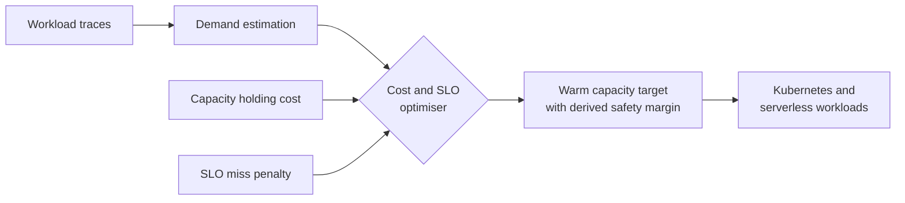

<!-- Banner -->

  

<!-- Typing line -->

  

  
  
  

<!-- One second hook -->
<table align="center">
  <tr>
    <td align="center" width="260">
      <h3>1 year</h3>
      Production operations at <b>Sysco LABS</b>, handling real incidents across AWS, Datadog and ServiceNow
    </td>
    <td align="center" width="260">
      <h3>WarmStock</h3>
      Final year research on <b>cost and SLO aware</b> warm capacity for Kubernetes and serverless
    </td>
    <td align="center" width="260">
      <h3>Platform first</h3>
      Kubernetes, CI/CD, GitOps and observability, designed with operations in mind from day one
    </td>
  </tr>
</table>

 

## 👋 About me

I build, automate and operate software platforms that stay simple under pressure. I started in software development, learned what breaks in production while supporting live systems at Sysco LABS, and now focus on DevOps and Platform Engineering. I care less about whether something runs once and more about how it is deployed, observed, scaled and kept healthy at 3 a.m.

## 🔬 Featured research · WarmStock

Keeping capacity warm costs money, and keeping too little of it costs SLO misses. Most teams pick a safety margin by gut feeling. WarmStock treats that margin as an **output of an optimisation**, balancing the cost of holding ready capacity against the penalty of requests that miss their performance objective.

  
  
  
  
  

## 💼 Experience

**Intern Operations Engineer at Sysco LABS** &nbsp;·&nbsp; May 2025 to May 2026

I supported production applications and operational workflows in a live support environment, investigating incidents with Amazon CloudWatch, Datadog and ServiceNow. Much of my time went into troubleshooting data movement problems such as CDC latency and failing scheduled jobs, and I contributed documentation and automation that cut down repetitive operational work.

## 🎯 What I focus on

<table>
  <tr>
    <td>☸️ <b>Platform Engineering</b> Kubernetes environments, reusable platform workflows, infrastructure automation</td>
    <td>🚀 <b>DevOps and Delivery</b> CI/CD pipelines, containers, deployment automation, GitOps</td>
  </tr>
  <tr>
    <td>📈 <b>Reliability and Observability</b> Monitoring, incident investigation, service health</td>
    <td>🔄 <b>Data and Event Streaming</b> Kafka, Debezium CDC, cloud data pipelines</td>
  </tr>
</table>

## 🧰 Toolkit

**Used in production**

  
  
  
  

**Labs, research and projects**

  

  

  
  
  
  
  
  

## 📊 GitHub activity

  
  

## 🌱 Right now

🔭 Building and evaluating WarmStock for my final year research 
☸️ Going deeper on Kubernetes internals, cloud infrastructure and platform reliability 
🧠 Learning to design systems that are repeatable, observable, scalable and cost aware

 

  <b>Design simply. Automate reliably. Scale thoughtfully.</b>

  

